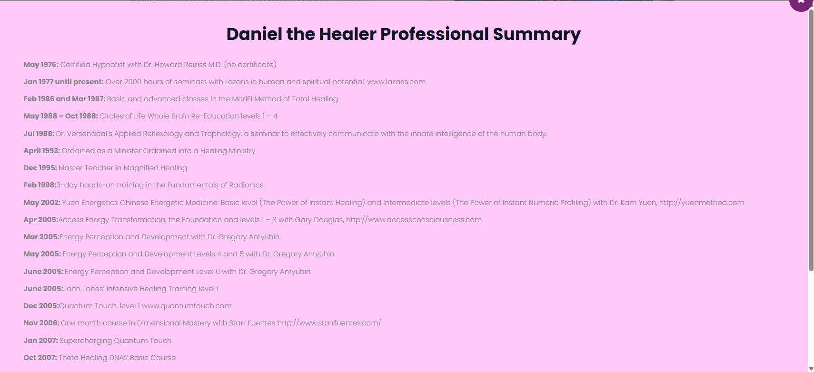

http://localhost:3000/daniel--> see more click korle emon modal hbe image jemon omn. 
text hbe : 

Daniel the Healer Professional Summary
May 1976: Certified Hypnotist with Dr. Howard Reiziss M.D. (no certificate)
Jan 1977 until present: Over 2000 hours of seminars with Lazaris in human and spiritual potential. www.lazaris.com
Feb 1986 and Mar 1987: Basic and advanced classes in the MariEl Method of Total Healing.
May 1988 – Oct 1988: Circles of Life Whole Brain Re-Education levels 1 – 4
Jul 1988: Dr. Versendaal’s Applied Reflexology and Trophology, a seminar to effectively communicate with the innate intelligence of the human body.
April 1993: Ordained as a Minister Ordained into a Healing Ministry
Dec 1995: Master Teacher in Magnified Healing
Feb 1998:3-day hands-on training in the Fundamentals of Radionics
May 2002: Yuen Energetics Chinese Energetic Medicine: Basic level (The Power of Instant Healing) and Intermediate levels (The Power of Instant Numeric Profiling) with Dr. Kam Yuen, http://yuenmethod.com
Apr 2005:Access Energy Transformation, the Foundation and levels 1 – 3 with Gary Douglas, http://www.accessconsciousness.com
Mar 2005:Energy Perception and Development with Dr. Gregory Antyuhin
May 2005: Energy Perception and Development Levels 4 and 5 with Dr. Gregory Antyuhin
June 2005: Energy Perception and Development Level 6 with Dr. Gregory Antyuhin
June 2005:John Jones’ Intensive Healing Training level 1
Dec 2005:Quantum Touch, level 1 www.quantumtouch.com
Nov 2006: One month course in Dimensional Mastery with Starr Fuentes http://www.starrfuentes.com/
Jan 2007: Supercharging Quantum Touch
Oct 2007: Theta Healing DNA2 Basic Course
Jan 2008: Healing and the Power of the Mind 2-day training with Harold McCoy
Dec 2008: Certified Quantum Touch Practitioner
Feb 2011: Oneness Awakening Course
Apr 2011: Quantum Touch Level 2
Aug 2015: Connecting with the Medicine Buddha: The Medicine Buddha Dharma. Taught by Douglas Sutton
July 2015 – August 2016: Holistic Healing Synthesis by the Dr. Wagner’s Complete Guide to Healing Body, Mind and Spirit
http://localhost:3000/daniel-interviews --> link gulo name wise thik vabe bosbe 
reference : 

The Moore Show
https://www.youtube.com/watch?v=pPRvISGYm9Y

Interview by Brent Michael Phillips with Awakening Dynamics
https://vimeo.com/293209695

Video interview with Sara Troy on Ignite Your Heart and Soul
“You Create Your Own Reality”

https://selfdiscoveryradio.com/2018/06/18/ig-18-25-you-create-your-own-reality/

Video Interview with Marla Martenson:
https://www.youtube.com/watch?v=HOmshjikdKk&t=55s

Interview with Dermot Butterly, the Celtic Coach
https://www.youtube.com/watch?v=v3TG5ouqicw&feature=youtu.be

Audio interview with Carry on Harry:
https://www.carryonharry.com/2017/experts2017/DanielTheHealer.mp3

Video interview with Magic Brad on Synergy Café:
“Holistic Healing 101 with Daniel the Healer and MagicBrad on SynergyCafe”

https://www.youtube.com/watch? v=jWuZXz2xXOw&t=32s

Video interview on Raising Reverence with Athena Starseed
Part 1:https://www.youtube.com/watch?v=6Ghw0MQNQwcPart 2:https://www.youtube.com/watch?v=g5C0JnYlUhkPart 3:https://www.youtube.com/watch?v=ocalpXmf5PsPart 4:https://www.youtube.com/watch?v=vIJHFE1Of6U

Audio interview with AJ on My Seven Chakras:
Episode 219: http://www.mysevenchakras.com/daniel-energy-healer/Episode 160: http://www.mysevenchakras.com/160/

Audio interview with Dr. Leslie Phillips on Unlocking Your Truth
https://drlesleyphillips.com/spirituality/basic-spiritual-metaphysics-explained/

scroll er time website stack hoi may be motion lines er confilct full website smooth scroll hbe
and  about service and shop --> pages every button uses are same as in footer contact us button and in these page increse text size and image size user can read make resposnsive every device and make it profesional and dont change ui 